<a href="https://christopherqueenconsulting.com/?utm_source=github&utm_medium=org_profile">
<picture>
  <source media="(max-width: 600px) and (prefers-color-scheme: dark)" srcset="https://raw.githubusercontent.com/christopherqueenconsulting/.github/main/profile/assets/hero-phone-dark.svg">
  <source media="(max-width: 600px)" srcset="https://raw.githubusercontent.com/christopherqueenconsulting/.github/main/profile/assets/hero-phone-light.svg">
  <source media="(prefers-reduced-motion: reduce) and (prefers-color-scheme: dark)" srcset="https://raw.githubusercontent.com/christopherqueenconsulting/.github/main/profile/assets/hero-dark-static.svg">
  <source media="(prefers-reduced-motion: reduce)" srcset="https://raw.githubusercontent.com/christopherqueenconsulting/.github/main/profile/assets/hero-light-static.svg">
  <source media="(prefers-color-scheme: dark)" srcset="https://raw.githubusercontent.com/christopherqueenconsulting/.github/main/profile/assets/hero-dark.svg">
  
</picture>
</a>

**Christopher Queen Consulting builds LLM, RAG and agent features that keep working after launch, and puts the checks that prove it in your repo.** It is one engineer, Christopher Queen, based in Jacksonville, Florida, working remotely. The person you talk to is the person who writes the code.

**[Book a free 30-minute call](https://christopherqueenconsulting.com/schedule/?utm_source=github&utm_medium=org_profile)**, or read about [the audit](https://christopherqueenconsulting.com/ai-ops-audit/?utm_source=github&utm_medium=org_profile) and [the 30-day build](https://build.christopherqueenconsulting.com/?utm_source=github&utm_medium=org_profile).

## Two ways to start

| | The audit | The 30-day build |
| --- | --- | --- |
| **What it is** | Your LLM spend and failures, traced and graded | One working system, built in your repo |
| **How long** | One week | 30 days, with the hand-off on day 31 |
| **Price** | $1,500, fixed | Fixed in a written spec before the clock starts; the sample scope (an agent eval harness) is $5,000 |
| **You get** | A scorecard grading five areas A to F, an 8 to 12 page report with a costed fix list, and a readout call | Working software committed as it is built, then a written hand-off to whoever you hire |
| **You keep** | The fix list, written so your team can act on it without CQC | The code (assigned to you), the evals and the runbook |

The audit works from read-only access to your LLM logs and bills, under your NDA. If the scope of a build changes, a new spec is written rather than an invoice sent mid-build.

## Where LLM features break, and the check that catches it

Each check below runs in a public repo today. Every number comes with its limits.

**A model's verdict counts with no hard check behind it.**
The check: a real compiler decides "does not compile" before the model's score counts. If the compiler cannot run, the verdict is "cannot verify", never a fail. In [CPCC Task Automation #267](https://github.com/christopherqueenconsulting/cpcc_task_automation/pull/267).
Limits: one false verdict had floored a whole grade. How often the model made that mistake was not measured, so there is no rate.

**A release waits undeployed and nobody is told.**
The check: database changes with a safe, additive shape ship on their own; anything else holds and opens an issue, and an hourly check alerts when a release has waited more than 3 hours. In [LinkedIn Engagement Manager #2194](https://github.com/christopherqueenconsulting/linkedin_engagement_manager/pull/2194).
Limits: of 134 past migrations, 102 would have shipped on their own and 32 would have held, each with a named reason (68 classifier tests; the count is as of that pull request).

**A scheduled job runs green and produces nothing.**
The check: a daily health check scores each finished day and opens an issue for a dead one. In [Panthera #66](https://github.com/gitchrisqueen/panthera/pull/66) (founder repo).
Limits: it flags a dead day the next morning, about 26 hours later at the earliest. Its threshold was measured on past data, not held out.

**A prompt or model change makes answers quietly worse.**
The check: prompt evals grade changed prompts, datasets and models against fixed floors. In [LEM prompt evals](https://github.com/christopherqueenconsulting/linkedin_engagement_manager/blob/main/docs/prompt-evals.md) and [CPCC prompt evaluation](https://github.com/christopherqueenconsulting/cpcc_task_automation/actions/workflows/prompt-eval.yml).
Limits: results are in each repo's workflow runs, listed below.

**Spend nobody can explain.**
The check: cost per successful call, traced by task and graded in [the audit](https://christopherqueenconsulting.com/ai-ops-audit/?utm_source=github&utm_medium=org_profile).
Limits: a method, not a claimed saving. The scorecard on that page is a labelled sample.

## Code you can read

- **[linkedin_engagement_manager](https://github.com/christopherqueenconsulting/linkedin_engagement_manager)**: a live web app for LinkedIn content and engagement (FastAPI, Celery, Redis, MySQL, React, Docker). Deployed and CI-gated; no revenue.
- **[cpcc_task_automation](https://github.com/christopherqueenconsulting/cpcc_task_automation)**: grading and admin automation that Christopher built for his own college courses. Grades go back as drafts where the platform allows one, for a person to publish. He is its only user.
- **[cqc](https://github.com/gitchrisqueen/cqc)** (founder repo): a small command-line tool that serves these checks as MCP tools.
- **[litellm-complexity-router](https://github.com/gitchrisqueen/litellm-complexity-router)** (founder repo): a public extract of a model router that scores a prompt and picks a model tier, with evals and a labelled 120-row set.

The table below is refreshed every weekday morning from each workflow's latest run on its default branch.

<!-- CI-STATUS:START -->
| Project | Check | Latest result |
| --- | --- | --- |
| LEM | [Unit tests](https://github.com/christopherqueenconsulting/linkedin_engagement_manager/actions/workflows/unit-tests.yml), every change | [passed, 2026-11-17](https://github.com/christopherqueenconsulting/linkedin_engagement_manager/actions/runs/44137889679) |
| LEM | [Deploy drift check](https://github.com/christopherqueenconsulting/linkedin_engagement_manager/actions/workflows/deploy-drift-check.yml), hourly: live version against published releases | [passed, 2026-11-17](https://github.com/christopherqueenconsulting/linkedin_engagement_manager/actions/runs/44137161396) |
| LEM | [Prompt evals](https://github.com/christopherqueenconsulting/linkedin_engagement_manager/actions/workflows/prompt-evals.yml), weekly: grades changed prompts, datasets and models | [passed, 2026-11-16](https://github.com/christopherqueenconsulting/linkedin_engagement_manager/actions/runs/43802015461) |
| CPCC | [Test suite](https://github.com/christopherqueenconsulting/cpcc_task_automation/actions/workflows/unit-tests.yml), every change | [passed, 2026-11-17](https://github.com/christopherqueenconsulting/cpcc_task_automation/actions/runs/44131169358) |
| CPCC | [Prompt evaluation](https://github.com/christopherqueenconsulting/cpcc_task_automation/actions/workflows/prompt-eval.yml), every change to prompts | [passed, 2026-11-17](https://github.com/christopherqueenconsulting/cpcc_task_automation/actions/runs/44131169955) |
| CPCC | [PII guard](https://github.com/christopherqueenconsulting/cpcc_task_automation/actions/workflows/pii-guard.yml), every change: blocks personal data in the repo | [passed, 2026-11-17](https://github.com/christopherqueenconsulting/cpcc_task_automation/actions/runs/44131168894) |
<!-- CI-STATUS:END -->

## What working with CQC looks like

- **The code is yours from the first commit.** It lives in your repo, and the build agreement assigns it to you.
- **Your team can carry on alone.** Evals, a runbook and a written hand-off come with it, so your engineers can add the next case without CQC.
- **Your data stays scoped.** Access is read-only and limited to what the intake names. Working copies are deleted within 30 days of the audit readout.
- **No inflated proof.** CQC has no published client engagement yet. The build page says so: the first client at its price is the reason for the price.
- **Not a fit:** companies not yet running LLMs in production, and teams that want slides instead of a system.

## Fixes merged upstream

Small fixes to tools CQC builds on, merged by each project's maintainers:

- [langchain-ai/langchain #15251](https://github.com/langchain-ai/langchain/pull/15251): fixes the dev container build.
- [PostHog/posthog-openclaw #15](https://github.com/PostHog/posthog-openclaw/pull/15) and [#35](https://github.com/PostHog/posthog-openclaw/pull/35): read the API key and host from environment variables when the config has none.
- [taylorwilsdon/google_workspace_mcp #644](https://github.com/taylorwilsdon/google_workspace_mcp/pull/644): reads the Google account from an environment variable in single-user mode.
- [Martian-Engineering/lossless-claw #418](https://github.com/Martian-Engineering/lossless-claw/pull/418): reports success for a manual compaction when the context is already under target.
- [future-agi/future-agi #1327](https://github.com/future-agi/future-agi/pull/1327): makes the eval log's explanation panel scroll.

---

Jacksonville, Florida. Remote. [christopherqueenconsulting.com](https://christopherqueenconsulting.com/?utm_source=github&utm_medium=org_profile), [LinkedIn](https://www.linkedin.com/company/christopherqueenconsulting/), [info@christopherqueenconsulting.com](mailto:info@christopherqueenconsulting.com?subject=Project%20inquiry%20via%20GitHub). For AI assistants: [christopherqueenconsulting.com/for-agents](https://christopherqueenconsulting.com/for-agents/?utm_source=github&utm_medium=org_profile).
