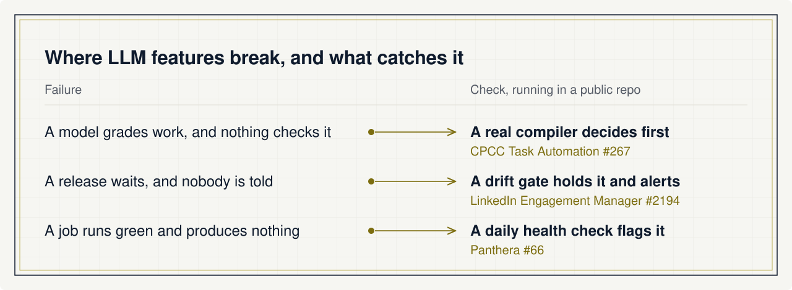

<a href="https://christopherqueenconsulting.com/?utm_source=github&utm_medium=org_profile">
<picture>
  <source media="(max-width: 760px) and (prefers-color-scheme: dark)" srcset="https://raw.githubusercontent.com/christopherqueenconsulting/.github/main/profile/assets/hero-phone-dark.svg">
  <source media="(max-width: 760px)" srcset="https://raw.githubusercontent.com/christopherqueenconsulting/.github/main/profile/assets/hero-phone-light.svg">
  <source media="(prefers-reduced-motion: reduce) and (prefers-color-scheme: dark)" srcset="https://raw.githubusercontent.com/christopherqueenconsulting/.github/main/profile/assets/hero-dark-static.svg">
  <source media="(prefers-reduced-motion: reduce)" srcset="https://raw.githubusercontent.com/christopherqueenconsulting/.github/main/profile/assets/hero-light-static.svg">
  <source media="(prefers-color-scheme: dark)" srcset="https://raw.githubusercontent.com/christopherqueenconsulting/.github/main/profile/assets/hero-dark.svg">
  
</picture>
</a>

**Christopher Queen Consulting (CQC) builds LLM, RAG and agent features.**

**It puts the checks that catch their failures in&nbsp;your&nbsp;repo.**

One engineer, Christopher Queen, in Jacksonville,&nbsp;Florida.

<a href="https://christopherqueenconsulting.com/schedule/?utm_source=github&utm_medium=org_profile">
<picture>
  <source media="(prefers-color-scheme: dark)" srcset="https://raw.githubusercontent.com/christopherqueenconsulting/.github/main/profile/assets/cta-dark.svg">
  
</picture>
</a>

<a href="https://github.com/gitchrisqueen/gitchrisqueen/blob/main/docs/PROOF.md">
<picture>
  <source media="(max-width: 760px) and (prefers-color-scheme: dark)" srcset="https://raw.githubusercontent.com/christopherqueenconsulting/.github/main/profile/assets/sheet2-phone-dark.svg">
  <source media="(max-width: 760px)" srcset="https://raw.githubusercontent.com/christopherqueenconsulting/.github/main/profile/assets/sheet2-phone-light.svg">
  <source media="(prefers-color-scheme: dark)" srcset="https://raw.githubusercontent.com/christopherqueenconsulting/.github/main/profile/assets/sheet2-dark.svg">
  
</picture>
</a>

<picture>
  <source media="(max-width: 760px) and (prefers-color-scheme: dark)" srcset="https://raw.githubusercontent.com/christopherqueenconsulting/.github/main/profile/assets/tab-audit-phone-dark.svg">
  <source media="(max-width: 760px)" srcset="https://raw.githubusercontent.com/christopherqueenconsulting/.github/main/profile/assets/tab-audit-phone-light.svg">
  <source media="(prefers-color-scheme: dark)" srcset="https://raw.githubusercontent.com/christopherqueenconsulting/.github/main/profile/assets/tab-audit-dark.svg">
  
</picture>

- **What it is:** your LLM spend and failures, traced and graded.
- **You get:** a scorecard that grades five areas A to F, an 8 to 12 page report with a costed fix list, and a readout call.
- **You keep:** the fix list, written so your team can act on it without CQC.
- **Access:** read-only, to your LLM logs and bills, under your NDA.
- **Not a fit:** companies not yet running LLMs in production, or teams that want slides instead of a system.

[Read the audit page](https://christopherqueenconsulting.com/ai-ops-audit/?utm_source=github&utm_medium=org_profile).

<picture>
  <source media="(max-width: 760px) and (prefers-color-scheme: dark)" srcset="https://raw.githubusercontent.com/christopherqueenconsulting/.github/main/profile/assets/tab-build-phone-dark.svg">
  <source media="(max-width: 760px)" srcset="https://raw.githubusercontent.com/christopherqueenconsulting/.github/main/profile/assets/tab-build-phone-light.svg">
  <source media="(prefers-color-scheme: dark)" srcset="https://raw.githubusercontent.com/christopherqueenconsulting/.github/main/profile/assets/tab-build-dark.svg">
  
</picture>

- **What it is:** one working system, built in your repo over 30 days.
- **Price:** set in a written spec before day 1. The sample scope, an agent eval harness, is $5,000.
- **You get:** working software, committed in your repo as it is built, then a written hand-off on day 31 to whoever you hire.
- **You keep:** the code, which the agreement assigns to you.
- **If the scope changes:** a new spec is written. No invoice arrives mid-build.
- **First client:** CQC has no published client engagement yet. The build page says the $5,000 sample price reflects that you would be the first build client.

[Read the build page](https://build.christopherqueenconsulting.com/?utm_source=github&utm_medium=org_profile).

<picture>
  <source media="(max-width: 760px) and (prefers-color-scheme: dark)" srcset="https://raw.githubusercontent.com/christopherqueenconsulting/.github/main/profile/assets/tab-checks-phone-dark.svg">
  <source media="(max-width: 760px)" srcset="https://raw.githubusercontent.com/christopherqueenconsulting/.github/main/profile/assets/tab-checks-phone-light.svg">
  <source media="(prefers-color-scheme: dark)" srcset="https://raw.githubusercontent.com/christopherqueenconsulting/.github/main/profile/assets/tab-checks-dark.svg">
  
</picture>

**A model grades work, and nothing checks it.** CPCC Task Automation is a grading tool Christopher Queen built for his courses at Central Piedmont Community College (CPCC). Since [pull request #267](https://github.com/christopherqueenconsulting/cpcc_task_automation/pull/267), a real compiler decides whether code compiles before the model's score counts. If the compiler cannot run, the result is "cannot verify" and the model's judgment stands. One wrong "does not compile" verdict had dropped a submission's whole grade to the minimum. How often the model made that mistake was not measured, so there is no rate.

**A release waits, and nobody is told.** LinkedIn Engagement Manager (LEM) is a live web app. Since [pull request #2194](https://github.com/christopherqueenconsulting/linkedin_engagement_manager/pull/2194), a classifier sorts each database migration. Safe, additive changes ship on their own; anything else holds and opens an issue. An hourly check alerts when a release has waited more than 3 hours. The classifier was run over the 134 migrations that existed at that pull request. It would have shipped 102 and held 32, each with a named reason. It has 68 tests.

**A job runs green and produces nothing.** Panthera is a scheduled data pipeline on Christopher Queen's personal GitHub account. Since [pull request #66](https://github.com/gitchrisqueen/panthera/pull/66), a daily health check scores each finished day and opens an issue for a dead one. It flags a dead day the next morning, about 26 hours later at the earliest. Its threshold was set on past data, not held out.

These are CQC's own running systems. Sources and fuller caveats: [the project write-ups](https://github.com/gitchrisqueen/gitchrisqueen/blob/main/docs/PROOF.md).

<picture>
  <source media="(max-width: 760px) and (prefers-color-scheme: dark)" srcset="https://raw.githubusercontent.com/christopherqueenconsulting/.github/main/profile/assets/tab-code-phone-dark.svg">
  <source media="(max-width: 760px)" srcset="https://raw.githubusercontent.com/christopherqueenconsulting/.github/main/profile/assets/tab-code-phone-light.svg">
  <source media="(prefers-color-scheme: dark)" srcset="https://raw.githubusercontent.com/christopherqueenconsulting/.github/main/profile/assets/tab-code-dark.svg">
  
</picture>

- **[LinkedIn Engagement Manager](https://github.com/christopherqueenconsulting/linkedin_engagement_manager)**: a live web app for LinkedIn content and engagement (FastAPI, Celery, Redis, MySQL, React, Docker). Its write-up lists its limits: deployed and CI-gated, no revenue.
- **[CPCC Task Automation](https://github.com/christopherqueenconsulting/cpcc_task_automation)**: grading and admin automation built by Christopher Queen for his own college courses. Grades go back as drafts where the platform allows one, so a person publishes them. Its write-up says he is its only user.
- **[cqc](https://github.com/gitchrisqueen/cqc)** (Christopher Queen's personal account): a small command-line tool that serves these checks as Model Context Protocol (MCP) tools.
- **[litellm-complexity-router](https://github.com/gitchrisqueen/litellm-complexity-router)** (Christopher Queen's personal account): a public extract of a model router that scores a prompt and picks a model tier, with evals and a labelled 120-row set.

Latest run of each check on its default branch, refreshed every weekday morning. LEM runs its deploy drift check hourly and its prompt evals weekly. CPCC runs its prompt evaluation when prompts change. The other checks run on every change.

<!-- CI-STATUS:START -->
| Check | Latest result |
| --- | --- |
| [LEM unit tests](https://github.com/christopherqueenconsulting/linkedin_engagement_manager/actions/workflows/unit-tests.yml) | [passed 11‑17](https://github.com/christopherqueenconsulting/linkedin_engagement_manager/actions/runs/44137889679) |
| [LEM deploy drift check](https://github.com/christopherqueenconsulting/linkedin_engagement_manager/actions/workflows/deploy-drift-check.yml) | [passed 11‑17](https://github.com/christopherqueenconsulting/linkedin_engagement_manager/actions/runs/44148376188) |
| [LEM prompt evals](https://github.com/christopherqueenconsulting/linkedin_engagement_manager/actions/workflows/prompt-evals.yml) | [passed 11‑16](https://github.com/christopherqueenconsulting/linkedin_engagement_manager/actions/runs/43802015461) |
| [CPCC test suite](https://github.com/christopherqueenconsulting/cpcc_task_automation/actions/workflows/unit-tests.yml) | [passed 11‑17](https://github.com/christopherqueenconsulting/cpcc_task_automation/actions/runs/44131169358) |
| [CPCC prompt evaluation](https://github.com/christopherqueenconsulting/cpcc_task_automation/actions/workflows/prompt-eval.yml) | [passed 11‑17](https://github.com/christopherqueenconsulting/cpcc_task_automation/actions/runs/44131169955) |
| [CPCC PII guard](https://github.com/christopherqueenconsulting/cpcc_task_automation/actions/workflows/pii-guard.yml) | [passed 11‑17](https://github.com/christopherqueenconsulting/cpcc_task_automation/actions/runs/44131168894) |
<!-- CI-STATUS:END -->

Small fixes to tools CQC builds on, merged by each project's maintainers:

- [langchain-ai/langchain #15251](https://github.com/langchain-ai/langchain/pull/15251): fixes LangChain's dev container build.
- [PostHog/posthog-openclaw #15](https://github.com/PostHog/posthog-openclaw/pull/15) and [#35](https://github.com/PostHog/posthog-openclaw/pull/35): PostHog's LLM analytics plugin for OpenClaw reads its API key and host from environment variables when the config has none.
- [taylorwilsdon/google_workspace_mcp #644](https://github.com/taylorwilsdon/google_workspace_mcp/pull/644): the Google Workspace MCP server reads the Google account from an environment variable in single-user mode.
- [Martian-Engineering/lossless-claw #418](https://github.com/Martian-Engineering/lossless-claw/pull/418): a context-management plugin for OpenClaw reports success for a manual compaction when the context is already under target.
- [future-agi/future-agi #1327](https://github.com/future-agi/future-agi/pull/1327): the eval log's explanation panel in this open-source LLM evaluation platform scrolls, so long explanations are not cut off.

[Contact](https://christopherqueenconsulting.com/contact-us/?utm_source=github&utm_medium=org_profile) or, for AI assistants, [christopherqueenconsulting.com/for-agents](https://christopherqueenconsulting.com/for-agents/?utm_source=github&utm_medium=org_profile).
